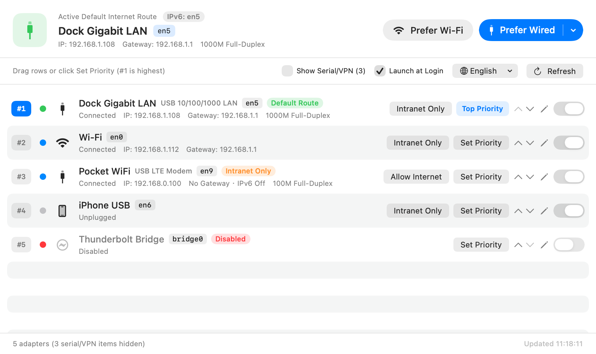

# NetPriority

English | [简体中文](README_CN.md)

[](https://www.apple.com/macos/)
[](https://swift.org)
[](https://github.com/wmwgz/net-priority/releases)
[](LICENSE)

A lightweight, native macOS **SwiftUI + AppKit** utility to manage macOS network service priority (Wi-Fi vs. multiple wired / USB Ethernet / mobile tethering interfaces), configure **Intranet-Only (no default gateway)** adapters in one click, and monitor your active default internet route live from both a clean window and the menu bar.



---

## Why NetPriority?

macOS decides which interface handles internet traffic strictly by the ordered list inside **System Settings → Network → Set Service Order…**. Changing it manually every time you plug in a dock, switch between Wi-Fi and Gigabit Ethernet, or connect an embedded/LTE USB modem is tedious—and existing toggle scripts usually fail when you have **multiple wired/USB devices** plugged in at once.

**NetPriority** solves this natively:

| Feature | NetPriority | Generic Wi-Fi/Ethernet Toggles | System Settings |
| :--- | :---: | :---: | :---: |
| One-click **Prefer Wi-Fi / Prefer Wired** | ✅ | ✅ | ❌ |
| Pick among **multiple wired / USB adapters** | ✅ | ❌ | Manual |
| One-click **Intranet-Only (no gateway, IPv6 Off)** | ✅ | ❌ | Multi-step |
| Drag-and-drop full service order (preserves hidden items) | ✅ | ❌ | Modal sheet |
| Auto-filter `J-Link`, `USB JTAG`, serial & empty VPN entries | ✅ | ❌ | Cluttered |
| Custom human-readable aliases (e.g. *Pocket WiFi*) | ✅ | ❌ | ❌ |
| Live Menu Bar status + instant exit switcher | ✅ | Partial | ❌ |
| Multi-language live switching (EN / 简体中文 / 日本語) | ✅ | Rare | OS restart |

---

## Detailed Usage Guide

### 1. One-Click Priority Switching (`Prefer Wi-Fi` / `Prefer Wired`)
- The top banner always displays your **Active Default Internet Route** (adapter name, BSD interface such as `en5`/`en0`, IPv4, default gateway, IPv6 interface, and link speed).
- The currently active mode button is highlighted in **blue**.
- Click **`Prefer Wi-Fi`** to move `Wi-Fi` to `#1` immediately.
- Click **`Prefer Wired`** to promote your primary active wired adapter to `#1`, or click the **dropdown arrow (`▾`)** next to it to promote any specific wired/USB device (such as Dock Ethernet vs. USB LTE Modem vs. iPhone USB).
- You can also click **`Set Priority`** on any individual row.

### 2. Drag-and-Drop Reordering & Per-Adapter Enable/Disable
- Drag any row in the list (or use **`↑` / `↓`**) to customize the exact priority order.
- Hidden services (such as debug serial ports or VPN extensions) are **automatically preserved in place** when you reorder visible adapters—nothing is ever dropped from `networksetup -ordernetworkservices`.
- Toggle the right-hand switch on any row to enable or disable that service immediately (`networksetup -setnetworkserviceenabled`).

### 3. One-Click「Intranet Only / Allow Internet」Mode
Ideal when you want to keep your main internet on one interface while accessing a local admin page or device subnet on another:
- **Example A (Wired Internet + Pocket Wi-Fi / Router USB Port)**: Plug in a USB LTE modem or router debug port (`192.168.0.x`) and click **`Intranet Only`**. NetPriority configures a manual IPv4 address **without a router gateway** and turns **IPv6 Off**, so `http://192.168.0.1` remains reachable while 100% of internet traffic stays on your Gigabit LAN or Wi-Fi.
- **Example B (Wired Internet + Embedded AP over Wi-Fi)**: Because `Intranet Only` is also enabled on **`Wi-Fi`**, you can connect Wi-Fi to a microcontroller AP / camera / travel router (`192.168.4.1`) without hijacking your wired Gigabit internet connection.
- Click **`Allow Internet`** at any time to restore **DHCP + Automatic IPv6**.
- **Right-click** the `Intranet Only` button to customize a static IPv4 address and subnet mask (defaults to the current IP or `192.168.0.100 / 255.255.255.0`).

### 4. Custom Aliases & Filtering Debug Ports
- Serial debuggers (`J-Link`, `USB JTAG/serial debug unit`, `/dev/cu.usbmodem*`) and virtual extensions without an active BSD interface (e.g. `Tailscale`) are hidden by default. Check **`Show Serial/VPN`** whenever you need to inspect the complete list.
- Click the **pencil icon (`✎`)** on any adapter to assign a readable alias (e.g., rename `200806006809080000` to `Pocket WiFi` or `USB 10/100/1000 LAN` to `Dock Gigabit LAN`). Aliases are saved locally in `UserDefaults`.

### 5. Menu Bar Resident Mode & Launch at Login
- Closing the main window hides it cleanly to the **Menu Bar** (`NSStatusBar`) instead of quitting, displaying your active exit icon and short name live.
- Click the Menu Bar item to switch priorities, pick a wired adapter, change language, toggle **`Launch at Login`**, or reopen the main window.
- Enabling **`Launch at Login`** writes a lightweight `LaunchAgent` (`~/Library/LaunchAgents/io.github.wmwgz.netpriority.plist`) with `--background` so it starts silently in the menu bar on reboot.
- Built-in **single-instance protection** ensures reopening `NetPriority.app` brings the existing window forward instead of spawning duplicate processes.

### 6. Multi-Language Switching
- Supports **Follow System**, **English**, **简体中文**, and **日本語**.
- Switch live from the **🌐 Language** picker in the toolbar or the **`Language`** submenu in the Menu Bar—no app restart required.

---

## Installation

### Option 1: Download Prebuilt Release (Recommended)
1. Download the build for your Mac from [**GitHub Releases**](https://github.com/wmwgz/net-priority/releases):
   - `NetPriority-v*-macos-universal.zip` — Universal binary for both Apple Silicon & Intel Macs *(recommended)*
   - `NetPriority-v*-macos-arm64.zip` — Apple Silicon only (`M1`–`M4`)
   - `NetPriority-v*-macos-x86_64.zip` — Intel Mac only
2. *(Optional)* Verify checksum:
   ```bash
   shasum -a 256 -c NetPriority-v1.0.0-macos-universal.zip.sha256
   ```
3. Unzip and drag `NetPriority.app` into `/Applications`.
4. **First launch note (Ad-hoc signed build)**: Because this open-source build is not signed with a paid Apple Developer ID certificate, macOS Gatekeeper may block the first launch. Clear the quarantine flag once:
   ```bash
   xattr -cr /Applications/NetPriority.app
   ```
   Then double-click `NetPriority.app` to launch.

### Option 2: Build from Source
Requires **macOS 14.0+** and **Swift 5.9+** (Xcode or Apple Command Line Tools):

```bash
git clone https://github.com/wmwgz/net-priority.git
cd net-priority
./scripts/build_app.sh
open /Applications/NetPriority.app
```

---

## Privacy, Permissions & Architecture

- **100% Local & Zero Telemetry**: NetPriority makes zero network calls of its own and stores only your custom aliases, last manual intranet IPs, and UI preferences in local `UserDefaults`.
- **Under the Hood**:
  - Reads service list, IP config, and link state via `/usr/sbin/networksetup`, `/sbin/ifconfig`, and `/sbin/route`.
  - Watches live hotplug and default route changes via macOS `SystemConfiguration` (`SCDynamicStore`) with zero busy polling.
  - Applies priority/IP mutations via `/usr/sbin/networksetup` directly when allowed, or prompts for native macOS admin authorization (`osascript` administrator privileges) only if required by system policy.

## Uninstall

1. Uncheck **Launch at Login** inside the app (or remove `~/Library/LaunchAgents/io.github.wmwgz.netpriority.plist`).
2. Quit **NetPriority** from the menu bar (`⌘Q`) and move `/Applications/NetPriority.app` to Trash.

## License

Released under the [MIT License](LICENSE).
