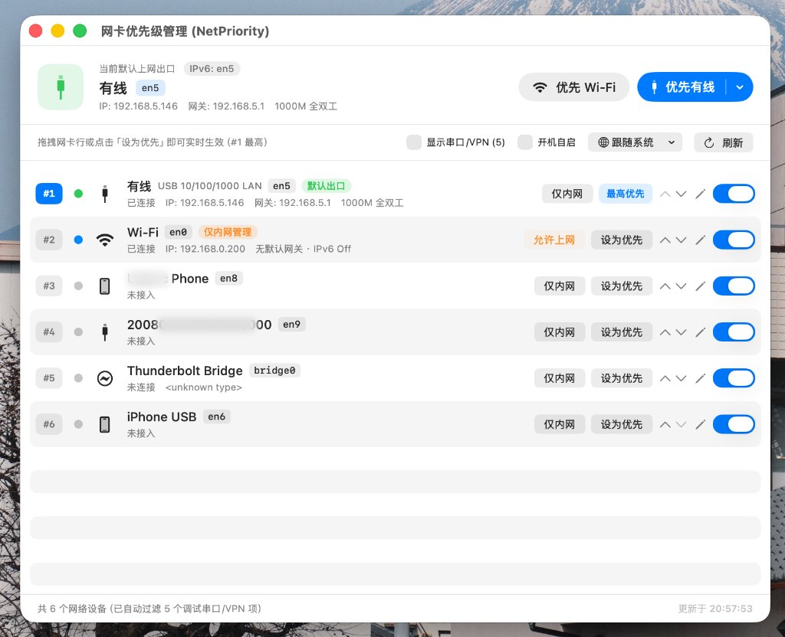

# NetPriority — macOS 网卡优先级与有线 / Wi-Fi 一键切换工具

[English](README.md) | 简体中文 | [日本語](README_JA.md)

[](https://www.apple.com/macos/)
[](https://swift.org)
[](https://github.com/wmwgz/net-priority/actions/workflows/ci.yml)
[](https://github.com/wmwgz/net-priority/releases)
[](LICENSE)

原生轻量 macOS（**SwiftUI + AppKit**）菜单栏网卡优先级管理工具：替代繁琐的 **macOS 设定服务顺序**，一键设置 **优先有线 / 优先 Wi-Fi**，支持在**多款扩展坞 / USB 千兆网卡 / 随身 WiFi / 手机 USB 共享**之间精准切换；同时支持一键开启「**仅内网管理（无默认网关）**」让**有线和 Wi-Fi 同时连接不冲突**，提供 **Apple Silicon 与 Intel 通用版**，并在主窗口和顶部菜单栏实时显示当前默认上网出口。



---

## 为什么做 NetPriority？

macOS 决定电脑从哪张网卡上网，靠的是 **系统设置 → 网络 → 设定服务顺序…** 里的排名。每次插拔扩展坞、在 Wi-Fi 和千兆网线间切换、或者插上随身 WiFi / 嵌入式设备调试时，手动去系统设置里拖来拖去非常繁琐；而市面上现有的小脚本大多只支持“Wi-Fi / 有线二选一”，面对**同时插着多款有线/USB 设备**的场景根本不够用。

**NetPriority** 专门解决这些实际痛点：

| 功能特性 | NetPriority | 同类小脚本/开关 | macOS 系统设置 |
| :--- | :---: | :---: | :---: |
| 一键切换 **优先 Wi-Fi / 优先有线** | ✅ | ✅ | ❌ |
| 区分并指定 **多款不同有线 / USB 设备** | ✅ | ❌ | 需手动拖拽 |
| 一键 **「仅内网管理（无网关 + 关 IPv6）」** | ✅ | ❌ | 需多步手填 |
| 拖拽完整排序（自动保留隐藏项顺位） | ✅ | ❌ | 弹窗层级深 |
| 自动过滤 `J-Link` / `USB JTAG` 串口与 VPN | ✅ | ❌ | 列表杂乱 |
| 自定义中文备注别名（如「随身WiFi」） | ✅ | ❌ | ❌ |
| 顶部菜单栏实时出口状态 + 秒切菜单 | ✅ | 部分支持 | ❌ |
| 四语言免重启热切换（中 / 英 / 日 / 跟随系统） | ✅ | 极少 | 需重启或切系统 |

---

## 详细使用说明

### 1. 一键切换优先级（`优先 Wi-Fi` / `优先有线`）
- 顶部信息卡片实时展示**当前默认上网出口**（设备名称、BSD 接口如 `en5`/`en0`、IPv4、默认网关、IPv6 接口与物理速率）。
- **当前实际生效的模式按钮会亮蓝高亮**，不会看错状态。
- 点 **`优先 Wi-Fi`**：立即把 Wi-Fi 提到 `#1`。
- 点 **`优先有线`**：一键把主用有线网卡提到 `#1`；点击按钮右侧 **`▾` 下拉箭头**，可以在**多款有线/USB 设备之间精准点选**某一台（例如区分扩展坞千兆网口、随身 WiFi、手机 USB 共享）。
- 也可以在列表中任意一行直接点 **`设为优先`**。

### 2. 拖拽排序与单网卡启用 / 禁用
- 直接**鼠标拖拽任意网卡行**（或点击行内 **`↑ / ↓`**）即可调整完整优先级顺序。
- 修改顺序时，底层会自动将隐藏的串口/VPN 服务按原相对位置合并传给 `networksetup -ordernetworkservices`，**绝不丢失或打乱系统隐藏项**。
- 每行最右侧的拨动开关可一键**启用或禁用**该网络服务。

### 3. 一键「仅内网管理 / 允许上网」
非常适合“主力网卡正常上网，同时副网卡连设备后台”的场景：
- **场景 A（插千兆网线上网 + USB 接随身 WiFi / 路由器）**：点随身 WiFi 那一行的 **`仅内网`**，软件会自动把它设为手动 IP（默认沿用当前 IP，若无则弹窗默认 `192.168.0.100 / 255.255.255.0`）、**不设默认网关并关闭 IPv6**。电脑既能顺畅访问 `192.168.0.1` 管理页，又**完全不会抢默认上网路线**。
- **场景 B（插有线网线上网 + Wi-Fi 连单片机/开发板热点）**：**`Wi-Fi` 行同样支持 `仅内网`**，连硬件热点调试时不会断掉有线网。
- 点 **`允许上网`**：一键恢复 DHCP 与 IPv6 自动获取。
- **右键**点击 `仅内网` 按钮可随时自定义手动 IP 与子网掩码。

### 4. 自动过滤杂项与中文备注
- `J-Link`、`USB JTAG/serial debug unit`、`usbmodem*` 调试串口以及无实际设备节点的 VPN 虚拟项（如 `Tailscale`）默认自动隐藏，勾选顶部 **`显示串口/VPN`** 可随时查看全部条目。
- 点击任意行的小铅笔图标 **`✎`**，可以起直观的备注名（如把序列号 `200806006809080000` 备注为 **`随身WiFi`**），本地持久化保存。

### 5. 菜单栏常驻与开机自启
- 关闭主窗口不会退出程序，而是缩回**顶部菜单栏**实时显示当前上网出口图标和名称，点开即可一键切网、开主窗口、切换语言或刷新。
- 勾选 **`开机自启`** 会生成 `~/Library/LaunchAgents/io.github.wmwgz.netpriority.plist`（附带 `--background` 参数，开机后静默驻留菜单栏不弹窗打扰）。
- 内置**单实例防多开保护**：重复双击应用会自动唤醒现有窗口，不会启动多个副本。

### 6. 多语言实时切换
- 支持 **跟随系统 / 简体中文 / English / 日本語**。
- 可在主窗口工具栏 **🌐 语言下拉** 或顶部菜单栏 **`语言 / Language`** 中随时切换，界面立即全局更新，无需重启。

---

## 下载与安装

### 方式一：直接下载 Release 安装包（推荐）
1. 前往 [**GitHub Releases**](https://github.com/wmwgz/net-priority/releases) 下载对应版本的安装包：
   - `NetPriority-v*-macos-universal.zip` — Intel + Apple Silicon 通用包 *(推荐)*
   - `NetPriority-v*-macos-arm64.zip` — Apple Silicon（M 系列芯片）专用包
   - `NetPriority-v*-macos-x86_64.zip` — Intel Mac 专用包
2. *(可选)* 校验压缩包 SHA-256：
   ```bash
   shasum -a 256 -c NetPriority-v1.0.0-macos-universal.zip.sha256
   ```
3. 解压后将 `NetPriority.app` 拖入 `/Applications`（应用程序）文件夹。
4. **首次打开提示（未公证说明）**：由于个人开源版未购买 Apple 开发者公证签名，首次双击可能会被 macOS Gatekeeper 拦截，在终端执行一次以下命令移除隔离属性即可正常打开：
   ```bash
   xattr -cr /Applications/NetPriority.app
   ```

### 方式二：从源码编译安装
环境要求：**macOS 14.0+**、**Swift 5.9+**（Xcode 或 Apple Command Line Tools 均可）：

```bash
git clone https://github.com/wmwgz/net-priority.git
cd net-priority
./scripts/build_app.sh
open /Applications/NetPriority.app
```

---

## 常见问题 (FAQ)

**如何不用每次打开系统设置就一键优先有线或优先 Wi-Fi？**  
直接在 NetPriority 主窗口或顶部菜单栏点击 **`优先有线`** / **`优先 Wi-Fi`** 即可，软件会立即调整 macOS 的网络服务顺序，并实时反馈当前实际生效的默认网关出口（如 `en5` / `en0`）。

**怎么实现“网线走外网，同时 Wi-Fi 或随身 WiFi 连内网管理页（`192.168.x.x`）不抢网”？**  
在需要仅访问内网的那张网卡（支持**所有有线/USB 网卡及 Wi-Fi**）点击 **`仅内网`**，软件会自动设置无网关的静态 IPv4 并关闭 IPv6，内网后台（如 `192.168.0.1`、`192.168.4.1`）照常访问，外网流量 100% 走主网卡；需要恢复时点 **`允许上网`** 即可恢复 DHCP。

**同时插着扩展坞网口、USB 网卡、随身 WiFi 等多台有线设备怎么区分？**  
普通脚本只能“Wi-Fi / 有线二选一”，NetPriority 支持点开 **`优先有线 ▾`** 下拉菜单精准指定某一张有线或 USB 设备排到第一位，还能用 **`✎`** 给序列号起中文备注名（如“随身WiFi”、“工位千兆网”）。

**这和自己在终端执行 `networksetup -ordernetworkservices` 有什么区别？**  
手写脚本重排服务顺序很容易把系统里隐藏的串口调试器（`J-Link`、`USB JTAG`）或 VPN 服务（如 `Tailscale`）漏掉甚至覆盖。NetPriority 在界面默认过滤杂项的同时，底层重排时会自动把所有隐藏服务按原顺位完整保留并传回系统。

**支持 Intel Mac 和 Apple Silicon（M1–M4）吗？**  
原生支持。GitHub Releases 提供合二为一的通用安装包（`NetPriority-v*-macos-universal.zip`）以及独立的 `arm64` / `x86_64` 包，适用 macOS 14.0 及以上系统。

---

## 隐私、权限与原理说明

- **完全本地运行、零联网遥测**：软件自身不发起任何网络请求，仅在本地 `UserDefaults` 中保存你的备注名、手动内网 IP 记忆和界面偏好。
- **底层实现**：
  - 通过 `/usr/sbin/networksetup`、`/sbin/ifconfig`、`/sbin/route` 读取服务顺序、网卡状态与默认路由；
  - 通过 macOS 原生 `SystemConfiguration`（`SCDynamicStore`）事件通知监听热插拔与路由变更，无轮询开销；
  - 优先直接调用 `networksetup` 修改配置，仅当系统策略要求提权时才弹窗请求原生管理员授权。

## 卸载方式

1. 如开启过「开机自启」，先在软件里取消勾选（或删除 `~/Library/LaunchAgents/io.github.wmwgz.netpriority.plist`）。
2. 在菜单栏退出 `NetPriority`（`⌘Q`），然后把 `/Applications/NetPriority.app` 移到废纸篓即可。

## 开源协议

基于 [MIT License](LICENSE) 开源。
