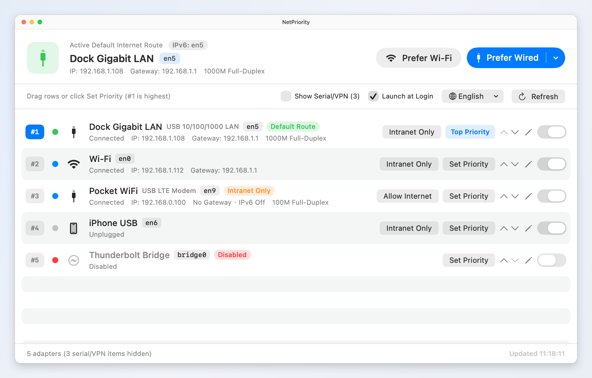
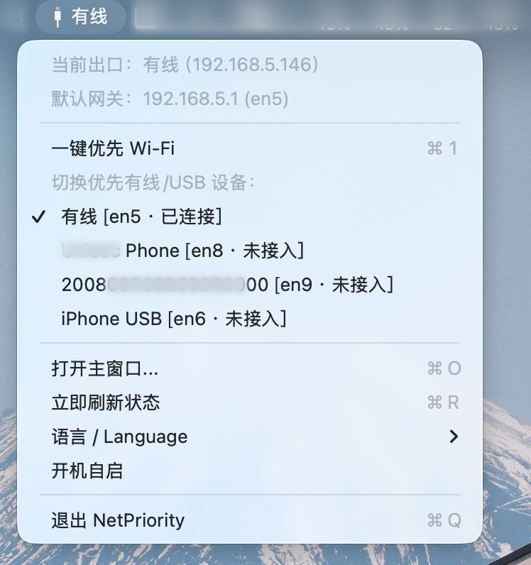

# NetPriority — macOS Wi-Fi・有線LAN 優先順位ワンクリック切替ツール

[English](README.md) | [简体中文](README_CN.md) | 日本語

[](https://www.apple.com/macos/)
[](https://swift.org)
[](https://github.com/wmwgz/net-priority/actions/workflows/ci.yml)
[](https://github.com/wmwgz/net-priority/releases)
[](LICENSE)

macOS の**ネットワークサービス順序**（`networksetup -ordernetworkservices`）をワンクリックで切り替えられる、ネイティブ軽量 **SwiftUI + AppKit** メニューバー常駐ユーティリティです。**Wi-Fi 優先 / 有線優先**の切替、複数の **USB イーサネット / ドック / LTE モデム / iPhone USB** の個別選択、**イントラネット専用（デフォルトゲートウェイなし）**設定、現在のデフォルトルート監視を **Apple Silicon & Intel（Universal Binary）** で提供します。



---

## 主な機能

- **ワンクリック優先切替（`Wi-Fi 優先` / `有線優先`）**：複数の有線・USB アダプタが接続されている場合も、分割ドロップダウン（`▾`）から特定のデバイスを指定して最優先に設定できます。現在有効なモードが青くハイライト表示されます。
- **ドラッグ＆ドロップ並べ替え＆個別有効/無効**：一覧から直感的に優先順位を調整可能。デフォルトで非表示にされる `J-Link`、`USB JTAG`、シリアルポート、VPN エントリの順序も内部で安全に保持されます。
- **ワンクリック「イントラネット専用 / インターネット許可」**：有線・USB アダプタだけでなく **Wi-Fi** でも利用可能。ルーター（デフォルトゲートウェイ）未設定のマニュアル IPv4 ＋ IPv6 オフを構成し、メインのインターネット回線を維持したままローカル管理画面（`192.168.0.1` や組み込み機器 AP など）へアクセスできます。
- **メニューバー常駐・ログイン時起動・カスタムエイリアス**：メインウィンドウを閉じてもメニューバーから現在のデフォルト出口を確認・即座に切替可能。各アダプタに分かりやすい別名（エイリアス）をローカル保存できます。
- **4言語ライブ切替**：システムに従う / English / 简体中文 / 日本語 を再起動なしで即時切替できます。

<p align="center">
  
</p>

---

## インストール方法

### 方法 1：ビルド済み Release をダウンロード（推奨）
1. [**GitHub Releases**](https://github.com/wmwgz/net-priority/releases) からお使いの Mac に合ったパッケージをダウンロードします：
   - `NetPriority-v*-macos-universal.zip` — Apple Silicon & Intel 両対応（推奨）
   - `NetPriority-v*-macos-arm64.zip` — Apple Silicon（M1〜M4）専用
   - `NetPriority-v*-macos-x86_64.zip` — Intel Mac 専用
2. *(任意)* SHA-256 チェックサムを検証：
   ```bash
   shasum -a 256 -c NetPriority-v1.0.0-macos-universal.zip.sha256
   ```
3. 解凍して `NetPriority.app` を `/Applications` へ移動します。
4. **初回起動時（未公証ビルドに関する注意）**：有料の Apple Developer ID 署名・公証を行っていないため、Gatekeeper にブロックされる場合は初回のみ以下を実行してください：
   ```bash
   xattr -cr /Applications/NetPriority.app
   ```

### 方法 2：ソースからビルド
必要環境：**macOS 14.0+**、**Swift 5.9+**（Xcode または Command Line Tools）：

```bash
git clone https://github.com/wmwgz/net-priority.git
cd net-priority
./scripts/build_app.sh
open /Applications/NetPriority.app
```

---

## プライバシーと仕組み

- **完全ローカル動作・テレメトリなし**：外部通信は一切行わず、カスタム別名や UI 設定のみローカルの `UserDefaults` に保存します。
- `/usr/sbin/networksetup`、`/sbin/ifconfig`、`/sbin/route` および `SystemConfiguration`（`SCDynamicStore`）イベント監視により低負荷・リアルタイムに動作します。

## ライセンス

[MIT License](LICENSE) の下で公開されています。
